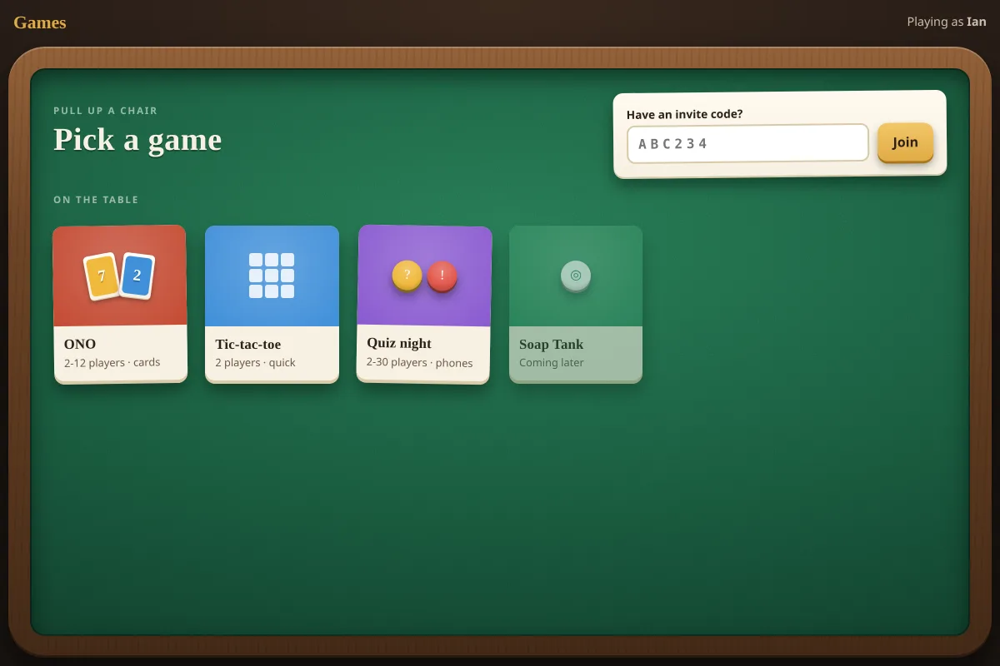
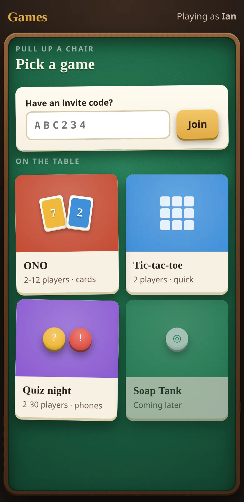
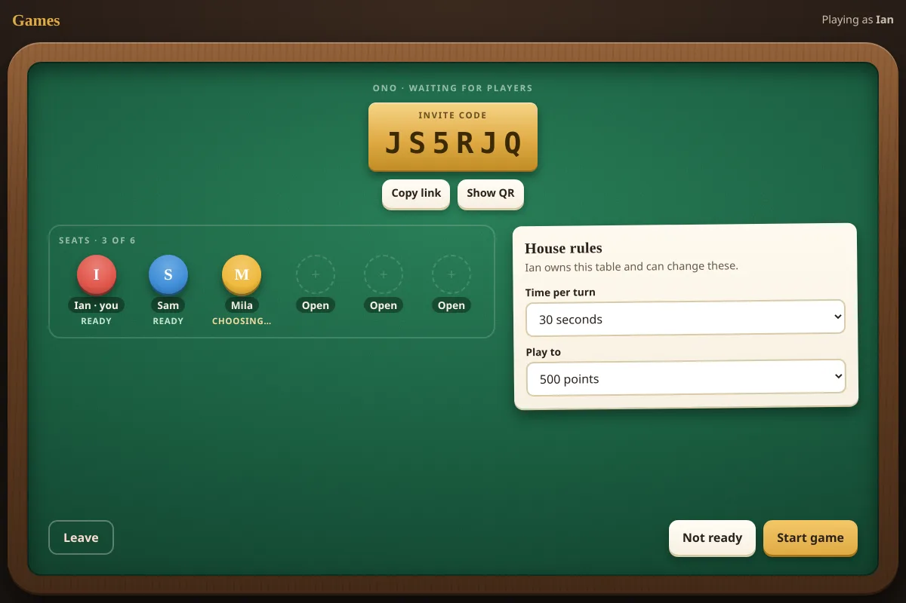
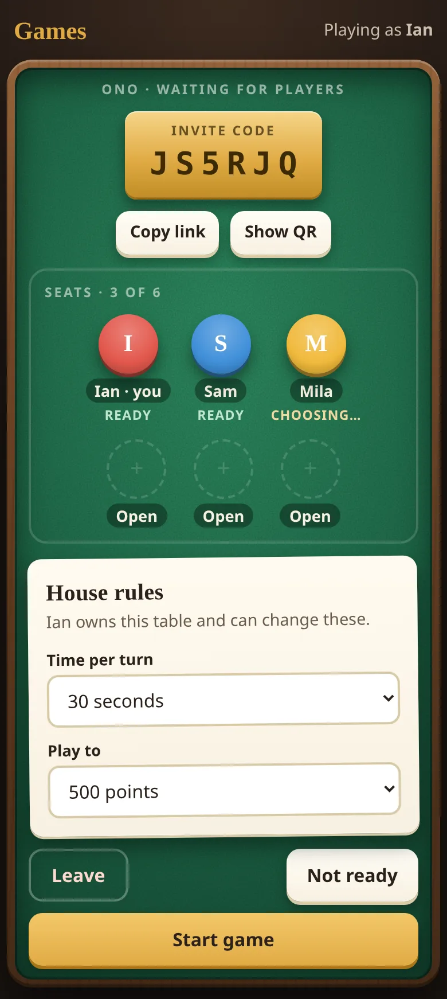
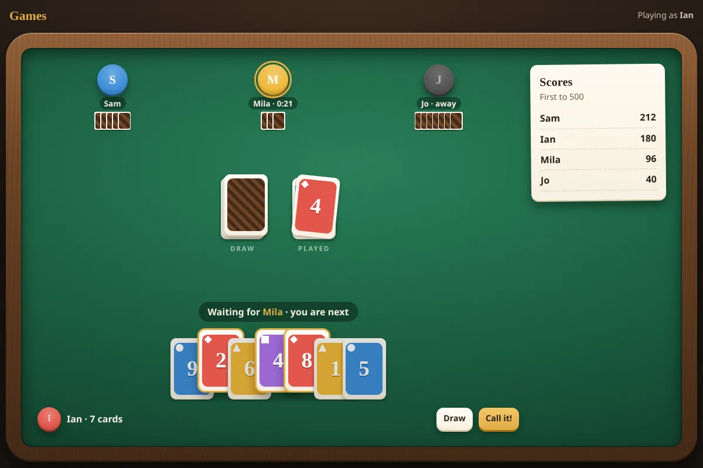
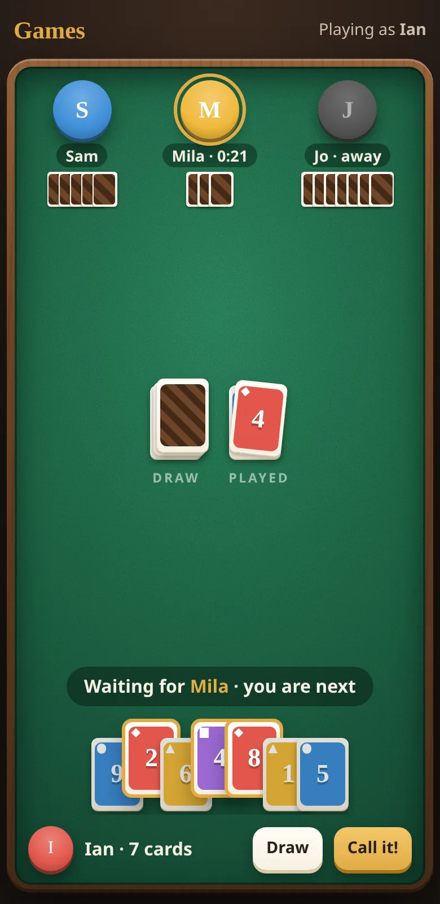

# Design: the table

Every screen on this site should feel like sitting down at a game table with
friends: a green felt surface, a raised wooden edge, and the game's pieces lying
on top. That includes the overview page and the lobby, not only the games.

This is the default for every game. A game may depart from it (see "When a game
leaves the table"), but it should do so on purpose.

Status: this document and the examples are the agreed direction. The live site
does not use this look yet. See "Getting there" at the end.

## Examples

Static mockups, built only from the stylesheet in
[`design/examples/table.css`](design/examples/table.css). Open the `.html` files
next to it in a browser to see them live and resize them.

|                                                                                               | Desktop                               | Phone                               |
| --------------------------------------------------------------------------------------------- | ------------------------------------- | ----------------------------------- |
| **Overview**: games are boxes lying on the table                                              |  |  |
| **Lobby**: invite code on a brass plaque, seats printed on the felt, rules on a slip of paper |     |     |
| **A card game**: opponents across the table, piles in the middle, your hand at your edge      |      |      |

The card faces in the mockup are placeholders to show the system, not the
design of any particular game.

## Philosophy

1. **One table, everywhere.** The same room, wood and felt on every page. A
   themed game inside a plain grey site reads as a costume. The reverse is true
   too: felt behind an unstyled form looks cheap.
2. **Everything is a thing.** If it is on screen, decide what it would be on a
   real table: a card, a token, a slip of paper, a brass plate, a line printed
   on the cloth. If it would be none of those, question whether it belongs.
3. **The game comes first, the table second.** The felt is a calm background so
   the pieces stand out. Texture, grain and shadow stay quiet. Nothing
   decorative ever sits behind text.
4. **Tactile, not heavy.** Depth comes from a small lift and one soft shadow,
   not from photos or bevels on everything. All of it is CSS. No image files.
5. **A phone is the main table.** Most players join from a phone. Every layout
   is designed at 360 px wide first and then given more room.
6. **Honest controls.** A control looks pressable and says what it does. The
   metaphor never makes an action slower or harder than a plain button would.

## The five layers

From back to front. Each has one job and its own colours.

| Layer      | What it is                            | Colours                                 | Used for                                                                                         |
| ---------- | ------------------------------------- | --------------------------------------- | ------------------------------------------------------------------------------------------------ |
| **Room**   | The dark, warm space around the table | `--room`, `--room-glow`                 | Page background, the site bar. Never holds game content.                                         |
| **Wood**   | The raised rail around the felt       | `--wood`, `--wood-light`, `--wood-dark` | The table edge. Sparingly for other "built" things, such as card backs.                          |
| **Felt**   | The playing surface                   | `--felt`, `--felt-light`, `--felt-dark` | Everything happens here. Lines and small labels can be "printed" on it.                          |
| **Pieces** | Things lying on the felt              | `--paper`, `--ink`, player colours      | Cards, tokens, game boxes, paper slips with forms and scores.                                    |
| **Brass**  | The one accent                        | `--brass`                               | The single most important action on a screen, the invite code, whose turn it is, keyboard focus. |

Rules that follow from the layers:

- **Text you read at length goes on paper**, dark ink on cream. Forms, settings,
  scores and rules are paper slips.
- **Text on felt is short and large**: a title, a status line, a name. Small
  text on felt sits on a dark pill (see the name tags and the status line).
- **Brass is rationed.** At most one brass button per screen. Besides that,
  only the invite code, the turn marker and the focus ring are brass. If
  everything is brass, nothing stands out.
- **Light comes from the top.** Highlights on top edges, shadows below. Never
  mix directions.

## Colour

The values live in `table.css` as custom properties. Use the names, never the
hex values.

- **Felt green is the default.** A game may swap the felt colour (a deep blue or
  burgundy table) by overriding the three `--felt` values. The wood and room
  stay the same so the site still feels like one place.
- **Cream on felt is readable, with a limit.** Cream text on the base felt is
  about 5.6:1 contrast, and about 3.6:1 at the lightest point of the gradient.
  That is why small text on felt gets a dark pill.
- **Colour is never the only signal.** Every player colour and every card colour
  is paired with a shape (circle, diamond, triangle, square). Red and green of
  similar darkness are indistinguishable to many players, and green pieces
  vanish on green felt, so green is not a player or card colour.
- **There is no light or dark mode.** The table is the theme. It is already dark
  enough for night and has enough contrast for daylight.
- **Red is for danger and leaving**, never for the main action.

## Type

- **Display**: a warm serif with some character (`--font-display`) for titles,
  card numbers and tokens. It is what makes the site feel like a game box and
  not a dashboard.
- **Interface**: a rounded sans (`--font-ui`) for everything else.
- Both fall back to fonts already on the device. If we ship fonts, they are
  WOFF2, self-hosted, and within the asset budget in `limitations.md`.
- Numbers on cards are large and repeated in a corner with the card's shape, so
  a card is identifiable when only its corner shows in a fanned hand.
- Minimum sizes: 16 px for body text, 14 px for labels, never smaller.

## Phone rules

These are requirements, not suggestions.

- **The rail shrinks, the felt stays.** Below 560 px the wooden edge becomes a
  7 px hint and the felt takes the screen. Decoration never costs card space.
- **Your seat is at the bottom.** Your hand and your actions sit in thumb reach.
  Opponents are a compact row at the top, not seats around an oval.
- **Portrait first.** Landscape must work, but nothing may require it. iOS
  cannot lock orientation.
- **Tap targets are at least 44 px.** For overlapping cards, the visible strip
  of each card is the target: never less than 28 px of a card showing, and the
  corner with its number and shape always visible.
- **Big hands scroll, they do not shrink.** Past what fits, the hand scrolls
  sideways or wraps to a second row. Cards never get smaller than 44 px wide.
  Tapping a card raises it before it is played, so a mis-tap is recoverable.
- **Respect the device edges.** Pad with `env(safe-area-inset-*)`. Game screens
  set `overscroll-behavior: none` so a drag does not reload the page.
- **The main action is a full-width button** at the bottom on phones.
- **No hover-only information.** Anything shown on hover is also reachable by
  tap.

## Components

The vocabulary every game shares. Names match the classes in `table.css`.

| Component                              | Looks like                                  | Use it for                                             |
| -------------------------------------- | ------------------------------------------- | ------------------------------------------------------ |
| `table` + `felt`                       | Wood rail around green cloth                | The frame of every page                                |
| `paper` (and `slip`, slightly rotated) | A cream card or note                        | Forms, settings, scores, rules, dialogs                |
| `plaque`                               | An engraved brass plate                     | The invite code                                        |
| `btn`                                  | A raised cream tile that sinks when pressed | Actions. `primary` is brass, `danger` is outlined red. |
| `token`                                | A round game piece with an initial          | A player. Ring = their turn. Grey = away.              |
| `seat`                                 | Token, name tag, status                     | Players in a lobby or around a table                   |
| `card`                                 | A cream-edged playing card                  | Cards. `back`, `playable` (raised, brass edge), `dim`  |
| `pile`                                 | A few cards stacked                         | Draw and discard piles                                 |
| `printed` and `felt-label`             | Pale lines and capitals on the cloth        | Grouping and labelling areas of the table              |
| `box` (overview only)                  | A game box seen from above                  | One game in the catalogue                              |

Before inventing a new component, check whether one of these is the right
physical object.

## Motion and sound

- **Pieces move, the table does not.** Cards slide and flip. Panels and the
  table never animate in.
- **Durations**: 150 ms for a hover or press, 200-300 ms for a card moving
  across the table, staggered by about 50 ms when several move.
- **Only `transform` and `opacity` animate.** Animating shadows, filters or size
  stutters on cheap phones.
- **A restored game does not replay.** After a reload the table appears as it
  is. Only moves that happen while you watch are animated.
- **`prefers-reduced-motion` is honoured**: pieces jump to their place.
- **Sound is off until the player turns it on**, and every game uses the same
  toggle.

## When a game leaves the table

Some games are not table games. A real-time arena game needs the whole screen
for its own world. The rule:

- **The room is constant.** The site bar, lobby, invite code, seats and
  end-of-game screens always use the table look. Players arrive at a table and
  come back to one.
- **The play area may be anything.** While playing, a game can replace the felt
  with its own canvas, edge to edge.
- **Keep the vocabulary where it fits**: tokens for players, brass for the main
  action, paper for menus.

Lighter departures (a different felt colour, a board laid on the felt, custom
card faces) are normal and need no justification.

## Do not

- Put a photo or a strong texture behind text.
- Use bitmap textures at all. The felt grain is an inline SVG filter and the
  wood grain is a gradient.
- Add bevels, gloss or shadows to more than the pieces. Flat felt, lifted
  pieces.
- Animate `box-shadow`, or use `backdrop-filter`.
- Shrink cards to fit more in.
- Use colour alone to tell players or suits apart.
- Reproduce the card faces, colours or layout of an existing commercial game.

## Checklist for a new game

- [ ] Works at 360 px wide in portrait, with the hand and main action in thumb reach
- [ ] Every tappable thing is at least 44 px, and overlapped cards show their corner
- [ ] Text on felt is short, large, or on a pill; anything longer is on paper
- [ ] At most one brass button per screen
- [ ] Each colour that carries meaning also has a shape
- [ ] Uses the shared components before adding new ones
- [ ] Animations use only transform and opacity and respect reduced motion
- [ ] No image files for the table, felt, wood or cards

## What this is based on

Research on 2026-11-18 into how other game sites handle this. Most of those
sites render with JavaScript, so their pages could not be inspected directly;
the findings rest on their own text, reviews, bug reports and design write-ups.

- Felt looks dated when the interface around it is bare; one industry piece
  describes old poker software as "a spreadsheet wearing a green felt hat"
  ([source](https://cogconnected.com/2026/01/how-online-poker-ui-is-taking-notes-from-video-games/)).
  Hence one metaphor on every page.
- Card games that treat the whole interface as one physical object are the ones
  reviewers praise for it
  ([Hearthstone's box](https://hearthstone.wiki.gg/wiki/Bad_cards)).
- On phones, players of a large board game platform report cards too close
  together to tap and hands pushed off-screen in portrait
  ([example](https://da.boardgamearena.com/bug?id=117912)). Hence the minimum
  sizes and "scroll, do not shrink".
- The same platform has no site-wide colour-blind support and players report
  colours they cannot tell apart
  ([thread](https://forum.boardgamearena.com/viewtopic.php?p=191597)). Hence a
  shape for every colour, built into the shared card and token.
- Known costs of skeuomorphism: clutter from ornate textures, slow loading, and
  low contrast that hides what is clickable
  ([Nielsen Norman Group](https://www.nngroup.com/articles/skeuomorphism/)).
  Hence CSS only, quiet texture, and paper for anything you read.
- Tap targets: 44 px is the enhanced accessibility level
  ([WCAG 2.2](https://www.w3.org/WAI/WCAG22/Understanding/target-size-minimum.html)).
- Animating anything other than transform and opacity repaints every frame
  ([web.dev](https://web.dev/articles/simplify-paint-complexity-and-reduce-paint-areas)).

## Getting there

Nothing in the running site uses this yet. The order to build it in:

1. Move the tokens from `table.css` into the Tailwind theme in `apps/web`, and
   wrap every page in the room, table and felt.
2. Restyle the shared entry screen and lobby in `packages/react` with paper,
   plaque, seats and buttons. Every game gets the look from this step alone.
3. Export the pieces (`Card`, `Token`, `Pile`, `Paper`, `Button`) from
   `packages/react` so games compose them and do not restyle their own.
4. Restyle tic-tac-toe as the template, then build ONO on the shared pieces.
5. Add the sound and reduced-motion settings to the shell.
